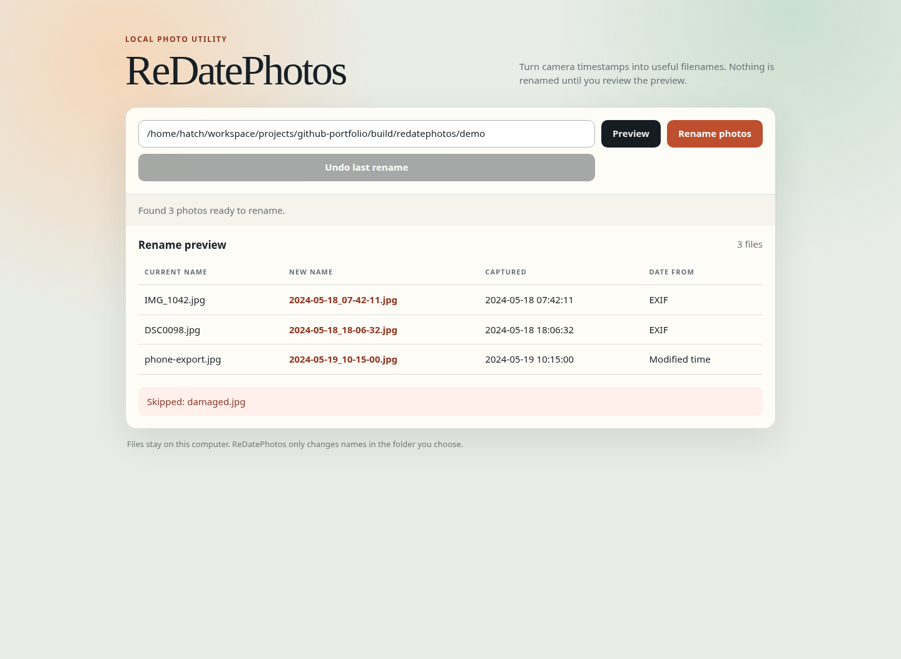

# ReDatePhotos

My camera roll had useful dates buried inside the photos and useless names on the outside. ReDatePhotos is a small local web app that previews sensible filenames, applies them as a batch, and lets you put the old names back if the result is not what you wanted.

It reads JPEG capture dates from EXIF metadata, falls back to the file's modified time, and sorts the whole folder chronologically. Nothing changes until you press **Rename photos**.



## What it does

- Reads `DateTimeOriginal`, `DateTimeDigitized`, and `DateTime` EXIF fields in that order.
- Falls back to filesystem modified time when a photo has no usable EXIF date.
- Previews names such as `2024-05-18_07-42-11.jpg` before touching the folder.
- Adds `_2`, `_3`, and so on when photos share a timestamp.
- Uses temporary names so photos can safely trade or reuse names within one batch.
- Skips damaged JPEGs and shows them in the preview.
- Keeps one local undo manifest and restores the previous names on request.

## Run it

ReDatePhotos needs Python 3.10 or newer.

```bash
python -m venv .venv
. .venv/bin/activate
pip install -e .
redatephotos
```

Open <http://127.0.0.1:5050>, paste the full path to a folder of photos, and choose **Preview**. The app listens only on localhost.

You can try it with the synthetic photos in [`demo/`](demo/). They were generated with Pillow and do not contain anyone's personal photos. `damaged.jpg` is deliberately invalid so the skipped-file state is visible.

## Tests

```bash
pip install -e '.[test]'
pytest
```

The suite covers EXIF reading, modified-time fallback, chronological sorting, duplicate timestamp conflicts, undo restoration, damaged images, and the Flask workflow.

## Dependency licenses

Every dependency declared by this project uses a permissive license:

| Dependency | Used for | License |
| --- | --- | --- |
| Flask | Local web interface | BSD-3-Clause |
| Pillow | JPEG and EXIF reading | HPND |
| pytest | Test suite (optional) | MIT |
| setuptools | Package build | MIT |

The application itself is available under the [MIT License](LICENSE).

## Known issues

- EXIF timestamps usually have no trustworthy timezone. ReDatePhotos treats them as local wall-clock times and does not convert them.
- Undo remembers only the most recent completed rename in a folder.
- A power loss or forced shutdown during the brief rename operation can leave temporary files that need manual recovery.
- Only top-level `.jpg` and `.jpeg` files are handled; folders are not scanned recursively.

## TODO

- Add a recovery command for interrupted rename operations.
- Offer an optional filename prefix without complicating the default preview.
